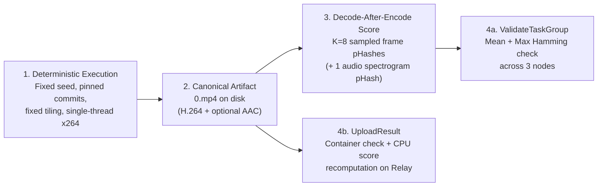

# VSS Validation Algorithm for Video Tasks

## 1. Context and Core Principle

Crynux validates task execution through Verifiable Secret Sampling (VSS):

1. **Hidden Sampling**: Each task is identified only by `TaskIDCommitment = Keccak256(TaskID || Nonce)`. Using a VRF over Relay's random `SamplingSeed`, roughly 1% of tasks (`beta mod 100 == 0`) are secretly dispatched to **3 independent nodes** with identical canonical `VideoTaskArgs` and commit-pinned model files.
2. **Score First, Upload Second**: Every node computes a compact hex `Score` locally and submits it (`SubmitScore`) before learning whether the task belongs to a 3-node validation group. Only after validation succeeds (`Validated` or `GroupValidated`, plus `EndInvalidated` for slash evidence) does the node upload `0.mp4` (`UploadResult`), avoiding redundant video uploads from `EndGroupRefund` validation nodes.
3. **Upload Integrity Check**: During `UploadResult`, Relay recomputes the score directly from the uploaded `0.mp4` on CPU (without a GPU) to verify that the uploaded file matches the previously validated `Score`.

### Why Perceptual Hashing Instead of Exact `SHA-256`

Crynux currently uses two validation paradigms:

- **LLM Tasks (`gpt-task`)**: Discrete token selection is autoregressive; a tiny floating-point difference that flips one token causes all subsequent tokens to diverge. LLM validation therefore pins all 3 group tasks to the **exact same GPU model and VRAM** (`RequiredGPU` + `RequiredGPUVRAM`) and requires **exact `SHA-256` equality**.
- **Image Tasks (`image_task`)**: Diffusion ODE denoising is continuous; small floating-point differences across GPU architectures produce visually near-identical images with minor pixel-level texture differences. Image validation therefore keeps an **open cross-GPU candidate pool** (any model-ready GPU meeting `MinVRAM`, filtered by `RequireLinuxCuda` when Linux-only quantized kernels are used) and compares **8-byte (64-bit) DCT perceptual hashes (`pHash`)** via Hamming distance.

Modern open-weight video models (`Wan 2.2`, `LTX-2.x`, `HunyuanVideo 1.5`, `MiniMax H3`, `CogVideoX`) are continuous Flow-Matching / ODE 3D DiT pipelines in the same mathematical family as 2D image diffusion—especially on image-anchored workflows (`I2V`, `FLF2V`, `V2V`) and 4-to-10-step distilled runs. Exact byte hashing (`SHA-256(0.mp4)`) is unsuitable because a single pixel or codec rounding difference across hundreds of megabytes invalidates the hash.

Compared with a single lossless PNG image, a generated video (`0.mp4`) introduces three concrete differences that the VSS algorithm addresses:

1. **Temporal sequence ($T$ frames) and sub-frame motion jitter**: Across different GPUs, a fast-moving edge can shift by about half a frame on one sampled timestamp while the rest of the clip matches closely.
2. **Lossy H.264 (`yuv420p`) compression**: Encoding RGB tensors to `0.mp4` slightly quantizes pixel values; scoring before compression and verifying after decompression would cause mismatches at `UploadResult`.
3. **Optional generated audio**: Joint audio-video models (`LTX-2.x`, `MiniMax H3`) output synchronized audio in `0.mp4`, which must also be covered so nodes cannot strip audio or mux silence.

---

## 2. Algorithm Overview

The algorithm has three parts:

1. **Deterministic execution and canonical MP4 encoding** inside `stable-diffusion-task` to remove all controllable randomness and discrete execution branches.
2. **Decode-after-encode multi-block `pHash` scoring** over $K = 8$ uniformly sampled video frames (plus 1 audio spectrogram block when an audio track is present), computed directly from the encoded `0.mp4` file.
3. **Two-level Hamming distance validation** (`mean` + `max`) across validation groups on Relay, paired with container and score verification on `UploadResult`.

---

## 3. Step 1: Deterministic Execution Contract

To ensure honest nodes stay within tight perceptual distance across runs and across GPUs, `stable-diffusion-task` enforces the following rules for every `video_task`:

1. **Exact Artifact Commit Pinning**:
   - Every repository in `base_model`, `components`, and `loras` is frozen by Relay to a 40-character commit SHA (`ExecutionModelFileHashes`). Relay rejects group validation if started members do not hold identical `ExecutionModelFileHashes`.
2. **Framework and CUDA Determinism**:
   - Set `CUDA_LAUNCH_BLOCKING=1` and `CUBLAS_WORKSPACE_CONFIG=:16:8`.
   - Enable `torch.use_deterministic_algorithms(True, warn_only=True)` (`warn_only=True` enforces deterministic kernels wherever implemented without crashing custom quantized or 3D ops that lack deterministic tags).
   - Set `torch.backends.cudnn.deterministic = True`, `torch.backends.cudnn.benchmark = False`, and IEEE FP32 precision (`tf32` disabled for CUDA matmul and cuDNN).
   - Run serial single-clip inference (`num_videos_per_prompt = 1`) with full GPU residency (**CPU and disk offloading are prohibited**).
3. **Device-Independent Noise Seeding and Concrete `dtype`**:
   - Seed Python `random`, `numpy`, and `torch`, and pass an explicit CPU generator `torch.Generator(device="cpu").manual_seed(seed)` into the pipeline so initial Gaussian latents (and any secondary upsampler or diffusion-decoder noise draws) are identical across GPU vendors and operating systems.
   - Resolve `dtype` (`"auto"` $\to$ active denoiser config `torch_dtype`, fallback `float32`) before loading weights, and force built-in prompt rewriters (`enable_prompt_enhancement`) to `False`.
4. **No Runtime Execution Branching**:
   - **Disable dynamic step-skipping caches** (`TeaCache`, `MagCache`, `FasterCache`, etc.): skipping a transformer forward pass based on a runtime floating-point residual threshold creates a discrete branching boundary where two GPUs can diverge sharply.
   - **Standard deterministic attention forward**: Use deterministic SDPA / FlashAttention forward; do not use approximate INT8/FP8 attention (`SageAttention`) in cross-GPU pools.
   - **Always-on VAE tiling**: Enable `vae.enable_tiling()` unconditionally with checkpoint-default tile sizes on every node, rather than toggling tiling dynamically based on free VRAM.
5. **Canonical Single-Threaded `0.mp4` Encoding**:
   - Encode the generated RGB frame array `(T, H, W, 3)` via `PyAV` using `libx264`, `pix_fmt="yuv420p"`, constant frame rate `resolved_fps`, `crf=18`, and `options={"threads": "1"}` (eliminating multi-threaded x264 rate-control differences across hosts with different CPU core counts).
   - When the pipeline outputs an audio waveform, mux it as stereo `aac` at the checkpoint's native sample rate into `0.mp4`.

---

## 4. Step 2: Score Construction from `0.mp4`

### Decode-After-Encode Rule

The score MUST be computed by decoding `0.mp4` **after** it is written to disk, never from pre-encoded in-memory tensors. Because the node hashes `0.mp4` before `SubmitScore` and uploads the exact same `0.mp4` bytes during `UploadResult`, both Node and Relay inspect the identical compressed bitstream.

### Visual Blocks ($K$ Sampled Frame `pHash` Blocks)

Let $T$ be the total number of video frames in `0.mp4` ($T = \text{task\_config.num\_frames}$) and set the sample count to:

\[
K = \min(8, T)
\]

For all standard video clips ($T \ge 8$), $K = 8$. Select $K$ deterministic 0-based frame indices spanning from the first frame ($0$) to the last frame ($T - 1$):

\[
t_i = \begin{cases}
0, & K = 1 \\
\left\lfloor \dfrac{i \cdot (T - 1)}{K - 1} \right\rfloor, & K > 1,\; i \in \{0, 1, \dots, K - 1\}
\end{cases}
\]

*(Example: for $T = 81$ and $K = 8$, the sampled indices are `[0, 11, 22, 34, 45, 57, 68, 80]`.)*

For each sampled frame $t_i$:

1. Extract its decoded 8-bit H.264 luminance (`Y` grayscale) plane of size $W \times H$ (avoiding `YUV -> RGB -> Gray` color-matrix rounding differences).
2. Downsample the luminance plane to a $32 \times 32$ matrix via exact partition box-averaging in `float64` (or the shared canonical `pHash` resizer) and apply the orthonormal 2D DCT-II.
3. Take the top-left $8 \times 8$ low-frequency coefficients (64 values), compute their median $m$, and pack a 64-bit integer (8 bytes, big-endian) where bit $j$ is `1` if coefficient $j > m$ and `0` otherwise.

This yields $K$ 8-byte visual blocks: $V_0, V_1, \dots, V_{K-1}$.

### Optional Audio Block ($+1$ Spectrogram `pHash` Block)

- **Silent video (`0.mp4` has no audio stream)**: No audio block is appended.
- **Audio-video (`0.mp4` contains an audio stream)**:
  1. Decode the audio stream to floating-point PCM and average channels to mono.
  2. Partition the full audio waveform into **32 equal-length contiguous time segments**. Within each segment, compute **32 uniform log-energy frequency bands** via a fixed real DFT/DCT, forming a single $32 \times 32$ time-frequency matrix representing the entire clip's audio envelope.
  3. Run the **same 2D DCT-II $8 \times 8$ median hash** on that $32 \times 32$ matrix to produce one 8-byte (64-bit) audio perceptual hash block $A$.

### Final Binary Score Layout

The submitted `Score` is the `0x`-prefixed hex encoding of:

\[
S = \begin{cases}
V_0 \,\|\, V_1 \,\|\, \dots \,\|\, V_{K-1} & \text{(no audio: } 8K \text{ bytes; } 64 \text{ bytes when } K=8\text{)} \\[4pt]
V_0 \,\|\, V_1 \,\|\, \dots \,\|\, V_{K-1} \,\|\, A & \text{(with audio: } 8(K+1) \text{ bytes; } 72 \text{ bytes when } K=8\text{)}
\end{cases}
\]

Every score is a non-zero multiple of 8 bytes, matching Crynux's existing 8-byte block convention.

---

## 5. Step 3: Relay Validation and Upload Verification

### 5.1 Cross-Node Group Comparison (`ValidateTaskGroup`)

When comparing two nodes' submitted scores $S_1$ and $S_2$ for a video task with expected frame count $T$ ($K = \min(8, T)$):

1. **Structural Check**: `len(S_1)` and `len(S_2)` MUST be equal and MUST be either $8K$ bytes (silent) or $8(K+1)$ bytes (with audio). If one node stripped audio (`64` bytes) while the honest nodes generated audio (`72` bytes), comparison immediately returns `false`.
2. **Two-Level Hamming Distance Rule**:
   Let $d_i = d_H(V_{1,i}, V_{2,i}) \in \{0, \dots, 64\}$ be the 64-bit Hamming distance on visual frame block $i$ ($0 \le i < K$), and let $d_{\text{audio}} = d_H(A_1, A_2)$ when the audio block is present. $S_1$ and $S_2$ **match** if and only if all of the following hold:

   \[
   \frac{1}{K} \sum_{i=0}^{K-1} d_i < \tau_{\text{mean}}, \qquad \max_{0 \le i < K} d_i < \tau_{\text{max}}
   \]

   and, when the audio block is present:

   \[
   d_{\text{audio}} < \tau_{\text{audio}}
   \]

   Initial calibration baselines (out of 64 bits):
   - $\tau_{\text{mean}} = 10.0$: keeps overall visual similarity across the clip strict, while averaging out a single-frame motion-edge phase shift between different GPU architectures.
   - $\tau_{\text{max}} = 20$: prevents an attacker from replacing 1 or 2 segments (such as truncating the ending) with unrelated frames while keeping the 8-frame average low.
   - $\tau_{\text{audio}} = 16$: verifies that both nodes synthesized matching temporal-spectral audio envelopes rather than silence or unrelated audio.

3. **Group Majority Outcome**:
   Relay applies the standard 3-node VSS majority table unchanged:
   - **3/3 match**: Fastest node enters `TaskGroupValidated`; the other two enter `TaskEndGroupRefund` (task fee shared by QoS weights `10 : 5 : 2`).
   - **2/3 match**: The two matching nodes pass; the outlier enters `TaskEndInvalidated` (recorded as slash evidence in `passive_slash_mode`, or slashed in active mode).
   - **No majority**: Finished tasks enter `TaskEndAborted` (`TaskAbortIncorrectResult`) with full fee refund.

### 5.2 Post-Validation Upload Verification (`UploadResult`)

When a node uploads `0.mp4`, Relay verifies the file on CPU before accepting the upload:

1. **Container Sanity Check**:
   - Verify `0.mp4` is a readable MP4 container with an H.264 video stream, decoded frame count $T = \text{task\_config.num\_frames}$, and matching `width` $\times$ `height` (when explicitly specified in `TaskArgs`).
   - Verify that the presence or absence of an audio stream matches the submitted score length ($8K$ vs. $8(K+1)$ bytes).
2. **Score Binding Check**:
   - Decode only the $K$ sampled frames $t_0, \dots, t_{K-1}$ (and audio PCM when present) on CPU and compute `uploadedScore`.
   - Require `len(uploadedScore) == len(task.Score)` and per-block Hamming distance $d_H \le \tau_{\text{upload}}$ against `task.Score`:
     - On visual blocks (computed from the integer bit-exact H.264 `Y` luma plane with the identical `float64` downsample + DCT formula), $\tau_{\text{upload,visual}} = 0$ (exact match, or $\le 1$ if third-party resizers are used).
     - On the audio block (where ARM64 vs. x86\_64 floating-point AAC decoders can differ by $\pm 1$ LSB), $\tau_{\text{upload,audio}} = 2$ bits—tolerating minor decoder rounding while keeping random forgery probability at $\sum_{j=0}^2 \binom{64}{j} 2^{-64} \approx 1.1 \times 10^{-16}$ per block.

---

## 6. Security Analysis and Pool Rollout

### Resistance to Cheating Strategies

| Attack Vector | Why It Fails |
| --- | --- |
| **Random or unrelated video** | A single random 64-bit block matches within $d_H < 14$ with probability $\sim 2 \times 10^{-6}$; across $K = 8$ blocks, false acceptance is negligible. |
| **Static keyframe freeze in `I2V` / linear cross-fade in `FLF2V`** | Although $t_0 = 0$ matches the input `image`, later sampled frames ($t_1 \dots t_7$) diverge beyond $\tau_{\text{mean}}$ whenever camera or subject motion occurs; under secret 1% VRF sampling, the node cannot tell which tasks are validated. |
| **Early stopping / rendering partial frames** | Sampled frames always include $t_{K-1} = T - 1$; 3D DiT models denoise all latent frames jointly at every step (so frame $T-1$ cannot be computed without running the full clip); and `UploadResult` checks total frame count $T$. |
| **Skipping audio synthesis on audio-video models** | Omitting the audio stream changes score length (`64` vs. `72` bytes); muxing silence or noise fails $d_{\text{audio}} < \tau_{\text{audio}}$. |
| **Post-validation file swap (honest `Score`, fake `0.mp4` upload)** | Rejected by `UploadResult` container and `uploadedScore` verification, resulting in `TaskAbortResultUploadTimeout` penalty and zero payout. |

### Validation Pool Policy and Calibration

1. **Cross-GPU Candidate Pool by Default**: Like `image_task`, `video_task` validation copies do not pin `RequiredGPU` by default; any qualified model-ready GPU satisfying `MinVRAM` (and `RequireLinuxCuda` when Linux-CUDA-only quantization is present) can join the group, maximizing pool size, dispatch speed, and Sybil resistance. If multi-GPU sequence/context parallelism is later enabled for large video models, its all-to-all/all-reduce collectives alter floating-point summation order and MUST remain in a separate GPU-name executor pool just like LLM `TP`.
2. **Safe Empirical Calibration via `passive_slash_mode`**: Launching `video_task` with `task.passive_slash_mode: true` automatically archives all 3 nodes' `Score` values, hardware snapshots, and uploaded `0.mp4` files whenever a group disagrees, allowing $(\tau_{\text{mean}}, \tau_{\text{max}}, \tau_{\text{audio}})$ to be verified against real production cross-GPU distance distributions before enabling automatic on-chain slashing.
